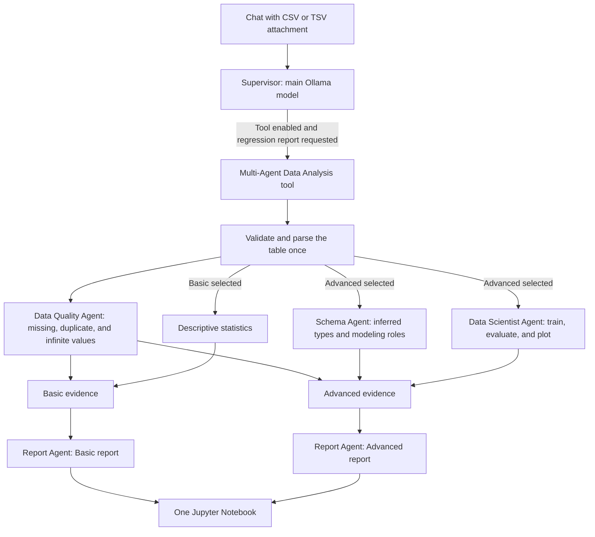

# Multi-Agent Data Analysis tool

The [target architecture](multi_agent_pipeline_architecture.png) separates routing, evidence collection, and report writing. The chat workspace exposes that workflow as one optional tool rather than a separate chat mode.

The diagram shows responsibilities, not concurrent execution. Only the Supervisor and Report Agent use Ollama. The Report Agent receives aggregate evidence, not table rows. It writes each selected report independently and falls back to a template for that level if Ollama cannot produce it. Exact duplicates are counted, not removed.

**Workspace settings → Tools** enables or disables the tool, selects an optional Report Agent model, and sets the report levels. **Basic** is on by default; it summarizes the selected numeric columns without training a model. **Advanced** adds a separate regression evaluation with held-out metrics and embedded plots. Both levels can be enabled, but at least one is required. The selected reports are saved as separate Markdown cells in one `.ipynb` file, with Advanced plots embedded as notebook attachments.

The backend does not advertise or execute the report tool for a disabled chat request, even if the main model emits a call by name. Table inspection and text reading still work. Direct analysis endpoints do not use browser preferences. The current tool handles UTF-8 CSV/TSV; JSON/Parquet ingestion and HTML/PDF output shown in the target architecture are not implemented.
