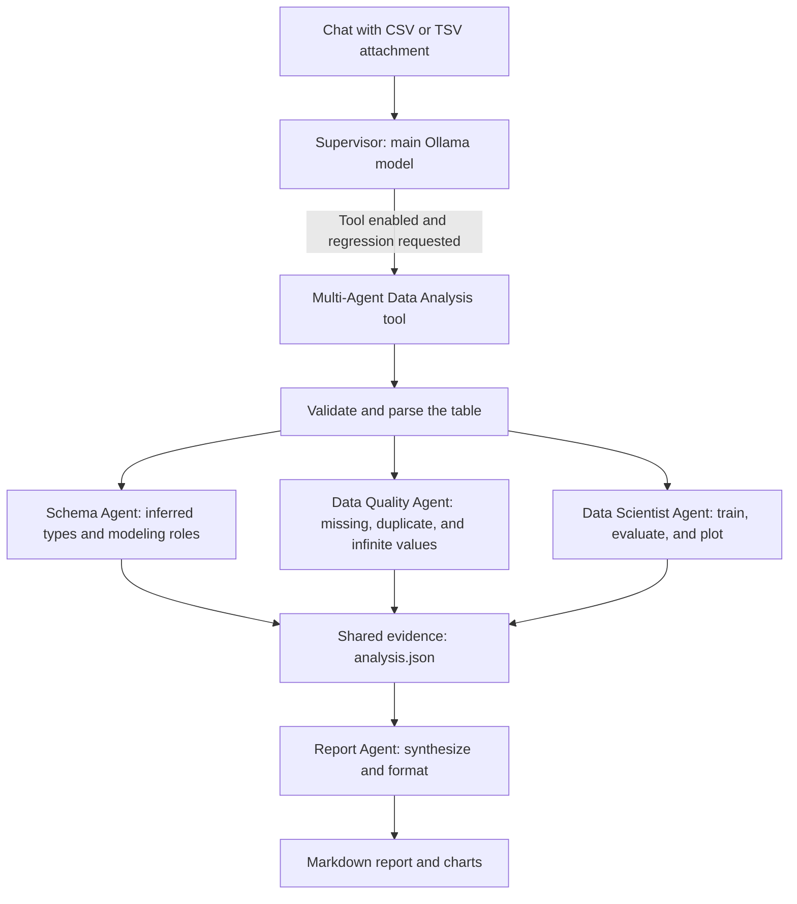

# Multi-Agent Data Analysis tool

The [target architecture](multi_agent_pipeline_architecture.png) separates routing, evidence collection, and report writing. The chat workspace exposes that workflow as one optional tool rather than a separate chat mode.

The diagram shows responsibilities, not concurrent execution. The backend coordinator runs the three evidence branches on one parsed table and writes a single handoff for the Report Agent. Only the Supervisor and Report Agent use Ollama. Field types are inferred from parsed values, and modeling roles come from the request; field meanings and business constraints are not inferred. Exact duplicates are counted, not removed.

**Workspace settings → Tools** enables or disables the tool and selects an optional Report Agent model. The backend does not advertise or execute the report tool for a disabled chat request, even if the main model emits a call by name. Basic table inspection and text reading are independent. Direct analysis endpoints are also independent of the browser preference.

The current tool handles UTF-8 CSV/TSV regression and emits Markdown. JSON/Parquet ingestion and HTML/PDF output shown in the target architecture are not implemented.
